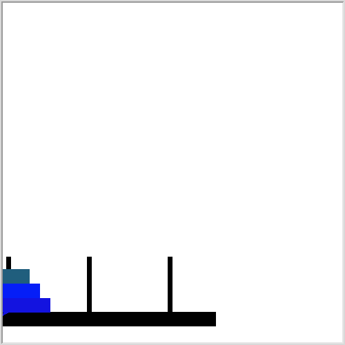

# Tower of Hanoi (Python + Turtle)

A playable **Tower of Hanoi** game in Python, drawn with the `turtle` module. It is one of my first programs, written during my first year of a Physics degree (L1), and the project that made me discover how much I enjoy programming.

The game interface (prompts and messages) is in French.



*Demo: 3 disks solved in 7 moves (a scripted run of the game, recorded with a small helper script that types the moves).*

## What it does
- Draws the three towers and up to 20 coloured disks on a Turtle canvas.
- Asks for the starting and arriving tower (0, 1 or 2) in the terminal, checks that the move is legal (no empty tower, no larger disk on a smaller one) and redraws the disks.
- Lets you **undo the last move** (`oui` / `non` after each move).
- Gives you a limit of 2<sup>n</sup> moves for n disks; you win when all disks are on the third tower.
- After a win, stores the player's name and number of moves per disk count in a dictionary.

## How the code is organised
`hanoi.py` is split in five parts, as in the original assignment:
| Part | Content |
|---|---|
| A | The board as a list of three lists (`init`, `verifDepl`, `verifVictoire`, ...) |
| B | Drawing with Turtle (`dessinePlateau`, `dessineDisque`, `effaceDisque`) |
| C | Player input and the game loop (`lireCoords`, `jouerUnCoup`, `boucleJeu`) |
| D | Undo (`dernierCoup`, `annulerDernierCoup`) |
| E | Score saving (`sauvScore`); displaying the scores is not finished |

## Run
```bash
python hanoi.py
```
Python 3 with the standard library only (`turtle` needs a graphical display and Tk).
